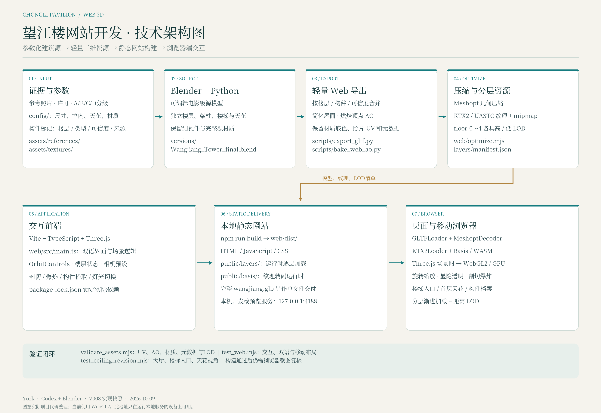
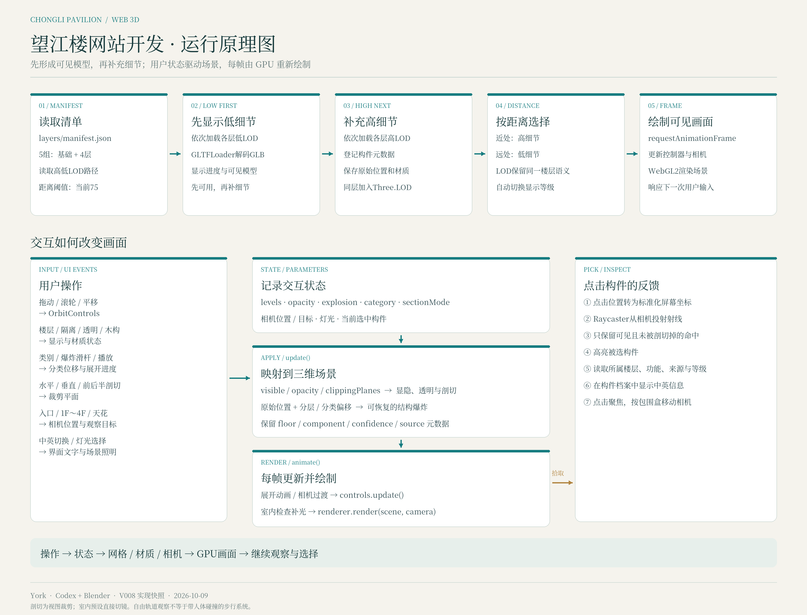

# York3D · 望江楼（崇丽阁）

[在线体验](https://york3d-wangjianglou.vercel.app) · [GitHub仓库](https://github.com/York8848/york3d-wangjianglou)

成都望江楼的中英文交互式三维展示。制作人 **York**，工具 **Codex + Blender**。使用 Vite、TypeScript 和 Three.js，支持楼层显隐、透明、结构展开、剖切、室内视角和构件来源查询。

这是照片辅助数字重建，非激光扫描或精确测绘。官方公布总高 27.9m；四层，下方上八角。上层内部、隐藏连接和楼梯路径保留推定标签。模型正面不代表地理北向。

## 本地运行

需要 Node.js 22：

```sh
npm ci --prefix web
npm run dev -- --port 4188
```

也可在 `web/` 内运行 `npm run dev -- --port 4188`。生产构建：`npm run build`，输出 `web/dist/`。

## Vercel

导入本仓库，Root Directory 保持仓库根目录。`vercel.json` 配置依赖安装、构建和输出目录；无需环境变量或后端。站点使用 WebGL2，首次加载低细节模型，再逐层补充高细节资源。

Vercel 已连接 GitHub 仓库：推送或合并到 `main` 后自动构建并更新正式网站；其他分支使用预览部署。构建设置以 `vercel.json` 为准。也可从仓库根目录执行 `vercel deploy --prod --scope york8848` 手动发布。

## 架构与原理





`web/src/main.ts`：双语界面、场景与交互。`web/public/layers/`：基础及四层的高低 LOD 模型；Meshopt 几何压缩与 KTX2 纹理。`web/public/basis/`：纹理转码运行时。`web/public/wangjiang.glb`：完整优化模型。

技术图解中的 Blender 导出链说明本地制作流程；本仓库交付运行网站及优化模型，完整 Blender 源工程、视频与原生帧保留在本地制作包。

## 开源许可

原始代码：MIT（见 [LICENSE](LICENSE)）。分发的模型：CC BY-SA 4.0。第三方照片、纹理及运行时保留其原有许可，详见 [ASSET_LICENSES.md](ASSET_LICENSES.md)。

Kcx36 的撑拱照片纹样经裁切与透视校正后用于模型，保留作者署名与 CC BY-SA 4.0；Daderot 的照片细节为 CC0。未经授权的研究图片与用户私有参考照片不在此仓库中。
